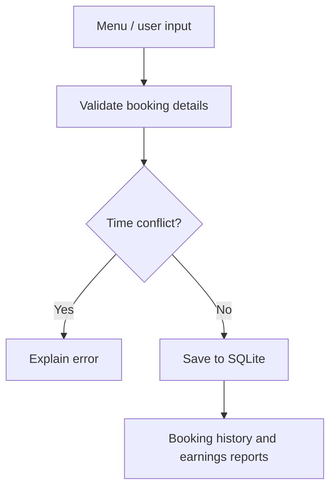

# Babysitting Booking & Earnings Tracker


A practical Python application for independent babysitters who need a reliable way to organise their bookings, avoid scheduling clashes and track their income.

## Features

- **Booking management:** create, view, edit and cancel bookings using unique IDs.
- **Conflict detection:** blocks overlapping sessions, including overnight bookings; back-to-back sessions are allowed.
- **Automatic earnings:** calculates pay from duration and hourly rate, to the nearest penny.
- **Booking statuses:** scheduled, completed and cancelled; cancelled bookings stay in the history but do not contribute to earnings.
- **Reports:** view weekly (Monday–Sunday) and monthly completed and projected earnings, hours and booking counts, including historical periods.
- **Persistence:** a local SQLite database automatically saves changes between sessions.
- **Demo mode:** try fictional bookings without touching your real records.
- **Automated tests:** validation, time conflicts, money calculations, reporting and persistence.

## Getting started

Install Python 3.10 or newer. No third-party packages are required.

```bash
git clone https://github.com/adeolaoyelola/Babysitting-tracker-.git
cd Babysitting-tracker-
python main.py
```

Alternatively, download and extract the repository, open a terminal in the project folder and run `python main.py`. On some computers the command is `python3 main.py`.

To try it without creating a database or entering personal information:

```bash
python main.py --demo
```

## Example workflow

```text
  BOOKING MANAGEMENT                  EARNINGS
  1. Add booking                      6. Weekly report
  2. View all bookings                7. Monthly report
  3. Edit booking
  4. Cancel booking                   0. Save & exit
  5. Mark booking completed
```

Example: create a fictional booking for 17:00–20:30 at £11/hour. The tracker calculates **3h 30m × £11.00 = £38.50**. If another booking overlaps that interval, the request is rejected and the original schedule is preserved.

To book an overnight session, enter the actual next day's date as the end date.

The reports distinguish completed earnings from scheduled earnings. A completed booking is manually marked as completed; this is a record of work done, not a verification of payment received. Overnight jobs are attributed to the date on which they begin, so their earnings are counted once. Times are local wall-clock times; daylight-saving clock changes are not adjusted automatically.

## How it works



The overlap condition is:

```python
new_start < existing_end and new_end > existing_start
```

The end of one booking can equal the start of the next without a conflict. The database performs conflict checks and writes within a transaction to avoid storing conflicting bookings, even if two instances attempt to save at once.

Rates are stored as integer pence; earnings use decimal arithmetic rounded once to the nearest penny per booking. This avoids binary floating-point inaccuracies.

## Project structure

```text
babysitting-tracker/
├── main.py                 # Interactive menu and demo
├── tracker.py              # Booking rules, database and earnings
├── tests/
│   └── test_tracker.py     # Automated regression tests
├── .github/workflows/
│   └── tests.yml           # GitHub Actions test workflow
├── .gitignore              # Excludes private data and temporary files
└── README.md
```

## Testing

```bash
python -m unittest discover -s tests -v
```

The test suite covers overnight shifts, fractional-hour pay, overlap rejection, back-to-back bookings, invalid input, editing, cancellations, earning periods and database persistence. GitHub Actions runs these tests on Python 3.10, 3.11 and 3.12 for every push and pull request.

## Privacy

The application stores booking information locally in `data/bookings.sqlite3` by default. Use client aliases instead of children's names, addresses or other sensitive personal details. The database is excluded from Git to avoid accidentally publishing actual booking information. Demo records are fictional and temporary.

## Possible future improvements

- Calendar-based graphical interface.
- Payment tracking and invoice generation.
- Configurable earnings targets and exportable reports.

## Author

Adeola Oyelola — technology and software development portfolio.
